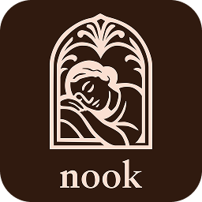
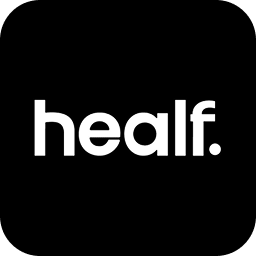
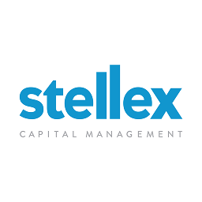
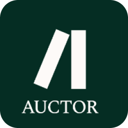
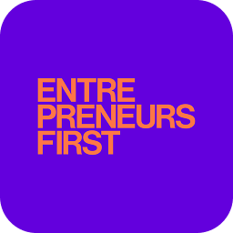
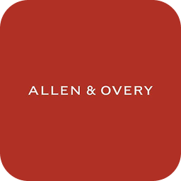

# Ray Apena

**2nd account.**

**Technical-commercial operator. I build the data systems behind the $$$: pipelines, geospatial models, integrations and the decisions they drive.**

## 💼 Work

First employee and now Commercial Lead at **Nook**, an autonomous, hardware-enabled hotel model. I took go-to-market from zero to a 300-room, five-year, $10.5M deployment, and built the geospatial site-ranking, channel integrations and acquisition pipelines underneath it. Before that I built production data pipelines and recommendation systems at **Healf**, originated special-situations deals in aerospace and defence at **Stellex**, and ran a $5M robotics-thesis investment at **Auctor**. I'm also an investment fellow identifying exceptional technical talent at **Entrepreneurs First**.

  &nbsp;&nbsp;
  &nbsp;&nbsp;
  &nbsp;&nbsp;
  &nbsp;&nbsp;
  &nbsp;&nbsp;
  

## 🎓 Study

Law, Art History and Philosophy at the **University of Cambridge** (Fitzwilliam College), with papers in aesthetics (philsophy of art), jurisprudence (philosphy of law), mathematical and philosophical logic. Credit Suisse Scholar (full scholarship), Allen & Overy Exhibitioner (1 of 3 academic bursaries awarded), and top ~0.5% of 23,000+ in the Credit Suisse Global Coding Challenge (2021).

  &nbsp;&nbsp;
  &nbsp;&nbsp;
  

## 🔩 Projects

Each project is tyipcally built around a real company's problem or an interesting technical aspect of one.

### Commercial
- **GreenLake metering & billing**  · Java, Spring Boot, Postgres. Pay-per-use billing that stays correct when CPU usage arrives late or twice. *Independent proposal for HPE.*
- **Store replenishment scheduler**  · Go. Urgency-weighted restocking on a custom heap, measured against standard scheduling policies. *Independent proposal for Walmart.*
- **Price & promo impact tool**  · Python, TypeScript, Next.js. Counterfactual readouts on loyalty-card data, validated on placebo dates. *Independent proposal for Quantium.*
- **Agentic wholesale transactions**  · TypeScript, Python. A buying agent with hard limits in code, tested against adversarial buyers. *Independent proposal for Fleek.*

### Technical
- **Analytical query engine**  · Go, WebAssembly. SQL over Parquet with a plan optimiser and an in-browser playground.
- **Hohfeld**  · Haskell, Z3. A custom-made typed language for legal relations that finds conflicts in contracts.

### Personal
- **UK site intelligence**  · Python, dbt, PostGIS, H3. Score any UK location for a business type from open data.

<!-- NOTE TO SELF:
REMEMBER...when a project ships, replace its bullet with a tile like this (image + link + headline result):

<table><tr><td width="50%" valign="top">
  
  <b>Project name</b> · Stack 
  One-line description with the headline number.
</td></tr></table>
-->

## 🧰 Stack

**Languages**

<picture>
  <source media="(prefers-color-scheme: light)" srcset="https://skillicons.dev/icons?i=py,ts,go,java,haskell&theme=light">
  
</picture>

**Data & infra**

<picture>
  <source media="(prefers-color-scheme: light)" srcset="https://skillicons.dev/icons?i=postgres,sklearn,fastapi,nextjs,docker,terraform,gcp&theme=light">
  
</picture>

## 📫 Contact

